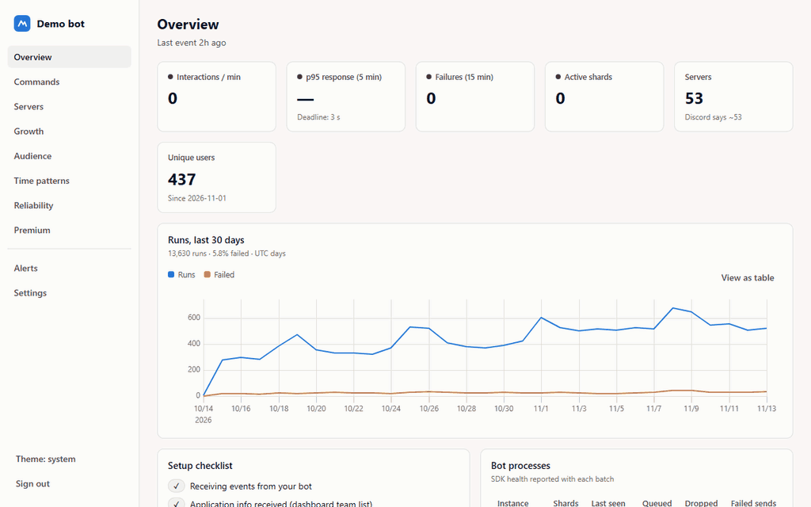

<div align="center">


# Shardlens

**Know what your Discord bot is doing, without spying on the people who use it.**

Self-hosted analytics and health monitoring for discord.js bots.<br />
Three lines to install. No privileged intents. User IDs never leave your bot.

[](https://github.com/Kkkermit/Shardlens/actions/workflows/ci.yml)
[](https://www.npmjs.com/package/@shardlens/discordjs)
[](https://discord.js.org)
[](tsconfig.base.json)
[](https://scorecard.dev/viewer/?uri=github.com/Kkkermit/Shardlens)
[](LICENSE)

[**Docs**](https://kkkermit.github.io/Shardlens/) ·
[Quick start](https://kkkermit.github.io/Shardlens/getting-started/quick-start/) ·
[Install with an AI agent](https://kkkermit.github.io/Shardlens/getting-started/install-with-an-agent/) ·
[What is collected](https://kkkermit.github.io/Shardlens/concepts/data-collected/) ·
[Privacy model](https://kkkermit.github.io/Shardlens/concepts/privacy-model/)



</div>

## Why Shardlens

- **Answers the questions you actually have.** Which commands are used, by how many people, in which servers, how
  often they fail, and whether you are answering inside Discord's 3-second deadline.
- **Private by design, not by policy.** User IDs are hashed inside your bot with a salt that rotates and is then
  destroyed. Message content is never collected. There is no per-user view to build.
- **Yours.** One `docker compose up` on your own server. No account, no telemetry, no vendor. MIT throughout.
- **Never hurts your bot.** Bounded memory, no I/O in event listeners, every SDK error caught and counted. Under 50
  microseconds per interaction.

## Quick start

**1. Run the collector** on any server with Docker and a domain pointing at it:

```sh
npx shardlens init --domain stats.example.com --app-id 123456789012345678
cd shardlens && docker compose up -d  # Caddy (HTTPS) → collector and dashboard → PostgreSQL
```

`init` writes the Compose file, a `.env` with generated secrets and keys, and a `bot.env` with the two settings your
bot needs. No server? [Embedded mode](https://kkkermit.github.io/Shardlens/self-hosting/embedded/) runs the collector
inside your bot instead.

**2. Add three lines to your bot** (`npm install @shardlens/discordjs`). Only the `Guilds` intent is needed:

```ts
import { Client, GatewayIntentBits } from 'discord.js';
import { createShardlens } from '@shardlens/discordjs';

const client = new Client({ intents: [GatewayIntentBits.Guilds] });
createShardlens(client, {
  endpoint: process.env.SHARDLENS_URL, // https://stats.example.com
  apiKey: process.env.SHARDLENS_INGEST_KEY, // slk_ingest_…
});
await client.login(process.env.DISCORD_TOKEN);
```

**3. Open the dashboard** at your domain and sign in with your read key (`SHARDLENS_READ_KEY` in `.env`), or with
Discord (the app owner and team) once you have set that up. `npx shardlens doctor` checks the bot's side.

**Already have a dashboard, or want none?** The dashboard is optional. `npx shardlens init … --dashboard own` runs
the collector as an API, and [`@shardlens/client`](packages/client) reads every number (and, in audit mode, who ran
what) into your own pages; `--dashboard none` runs it with no dashboard at all, for scripts, Discord reports, your own
database or Grafana. [Choose your setup](https://kkkermit.github.io/Shardlens/getting-started/choose-your-setup/)
compares them.

That's it. Add `lens.wrap(handler)` to record handler time and errors, `lens.wrapMessageCommand(name, handler)` for
prefix commands, `lens.track('ticket_opened', { … })` for your own events, and `lens.shutdown()` to flush on exit.

### Or paste this to your agent

Using Claude Code, Cursor, Copilot or Codex? Open your bot's repository and paste:

```text
Add Shardlens to this bot by following https://kkkermit.github.io/Shardlens/install.md
```

The [prompt](apps/docs/prompts/install.md) is self-contained: it tells the agent how to find your client, what to do
for `ShardingManager`, internal sharding and discord-hybrid-sharding, how to wrap your handler and flush on shutdown,
and what it must not touch (intents, audit mode, your keys). Its code samples are type-checked against the real
packages in CI. The docs are also published as plain text for agents
([`llms.txt`](https://kkkermit.github.io/Shardlens/llms.txt),
[`llms-full.txt`](https://kkkermit.github.io/Shardlens/llms-full.txt)). More in
[Install with an AI agent](https://kkkermit.github.io/Shardlens/getting-started/install-with-an-agent/).

## What you get

| Page            | What it tells you                                                                                                                                                                       |
| --------------- | --------------------------------------------------------------------------------------------------------------------------------------------------------------------------------------- |
| **Overview**    | Live interactions per minute, p95 response time, failures and shard state, streamed as they happen                                                                                      |
| **Commands**    | Runs, trend, unique users, servers, failure rate, p95, options used, channel types, languages and peak hours for every command, slash or prefix. Registered-but-unused ones are flagged |
| **Servers**     | Every server with its profile, usage and install history. Joins and removals that happened while the bot was offline are found at the next startup                                      |
| **Growth**      | Servers added and removed, size at install, activation within 24 hours, weekly retention cohorts, drift from Discord's own count                                                        |
| **Audience**    | Daily, weekly and monthly unique users, new against returning, stickiness, languages, install types. Counts only                                                                        |
| **Reliability** | p50/p95/p99 against the 3-second deadline, errors by Discord code, REST latency by route, 429s, the invalid-request budget, shards and SDK health                                       |
| **Events**      | Your `track()` events with property breakdowns, funnels across events and commands, and a cohort builder                                                                                |
| **Premium**     | Entitlements and subscriptions by SKU, premium share and estimated revenue                                                                                                              |
| **Alerts**      | Rules such as "missed deadlines above 1% for 10 minutes", posted to a Discord channel                                                                                                   |
| **Reports**     | A daily or weekly summary posted to a Discord channel of your choice: commands, users, failures, response time, servers, top commands                                                   |

## Works with your setup

- **Your own dashboard:** everything the built-in dashboard shows comes from one query endpoint, so you can
  [render it inside the dashboard you already have](https://kkkermit.github.io/Shardlens/guides/your-own-dashboard/).
- **discord.js 14.12+ and 15**, TypeScript or JavaScript, ESM or CommonJS, Node 22.12+.
- **Every sharding mode:** single process, `ShardingManager`, internal sharding and discord-hybrid-sharding.
- **HTTP-interaction bots** on Cloudflare Workers, Deno and Bun with [`@shardlens/http`](packages/http).
- **Your monitoring:** [Prometheus](packages/exporter-prometheus) and [OpenTelemetry](packages/exporter-otel)
  exporters with a ready-made Grafana dashboard, with or without a collector.
- **Small bots:** [embedded mode](https://kkkermit.github.io/Shardlens/self-hosting/embedded/) runs the collector
  inside your bot's own process. No Docker, no database server.
- **Your own database:** [copy every event](https://kkkermit.github.io/Shardlens/self-hosting/your-own-database/) into
  the MongoDB, MySQL, MariaDB, PostgreSQL or SQLite your bot already uses.
- **Platforms:** one-file templates for [Railway](https://kkkermit.github.io/Shardlens/self-hosting/railway/) and
  [Render](https://kkkermit.github.io/Shardlens/self-hosting/render/) in [`deploy/`](deploy).

Runnable [`examples/`](examples) cover a minimal bot, both sharding managers, audit mode and a Cloudflare Worker.
`pnpm sim` installs the packed packages into four differently built bots and runs them against a fake Discord, so
every release is checked the way you would use it.

## How it compares

|                                                    | Shardlens                           | [Discord Analytics](https://discordanalytics.xyz) | Discord's own counts (`GET /applications/@me`)              |
| -------------------------------------------------- | ----------------------------------- | ------------------------------------------------- | ----------------------------------------------------------- |
| Where your data lives                              | Your server only                    | Hosted, with a self-host option                   | Discord                                                     |
| Command usage, servers and growth                  | Yes                                 | Yes                                               | Approximate server and user-install counts only, no history |
| Response time against the 3-second deadline        | Yes, per command                    | Not in its docs                                   | No                                                          |
| REST health: latency, 429s, invalid-request budget | Yes                                 | Not in its docs                                   | No                                                          |
| Shard and gateway health                           | Yes                                 | Not in its docs                                   | No                                                          |
| User IDs                                           | Hashed inside your bot; never sent  | See its privacy policy                            | Not applicable                                              |
| Prometheus / OpenTelemetry export                  | Yes                                 | Not in its docs                                   | No                                                          |
| Libraries                                          | discord.js 14.12+ and 15, HTTP bots | discord.js, discord.py, Oceanic.js and more       | Any                                                         |

Based on each project's public documentation in November 2026. Spotted something out of date?
[Open an issue](https://github.com/Kkkermit/Shardlens/issues).

## Privacy and safety

- **No privileged intents.** Everything works with `GatewayIntentBits.Guilds`.
- **Pseudonymous by default.** User IDs are hashed in your bot process with a rotating salt that is destroyed when
  its period ends, so old hashes can't be linked to anyone. Raw IDs never leave the bot.
- **Public discord.js APIs only.** No monkey-patching, so discord.js updates don't break it, and the SDK never reads
  or cancels a response body discord.js still needs ([ADR 0009](docs/adr/0009-rest-response-safety.md)).
- **Hardened collector.** Validated input on every route, parameterised SQL, a strict Content Security Policy, rate
  limits everywhere, hashed keys and sessions. See the
  [threat model](https://kkkermit.github.io/Shardlens/operations/security/).

**Hashed or identified, your choice.** By default users are hashed and you see counts, never people. If you need to
know who ran a command (support, abuse handling), switch to identified users (audit mode): it records the user ID,
username and avatar and nothing else, has to be switched on in both the SDK and the collector, is encrypted at rest,
is kept for 30 days by default (90 at most), and every view, lookup and export is logged. Users can opt out or ask
for erasure with the ready-made `/privacy` command, and `npx shardlens privacy` prints a matching paragraph for your
privacy policy.

## Packages

| Package                                                          | Purpose                                                                         |
| ---------------------------------------------------------------- | ------------------------------------------------------------------------------- |
| [`@shardlens/discordjs`](packages/discordjs)                     | The discord.js adapter. This is the one you install                             |
| [`@shardlens/http`](packages/http)                               | For HTTP-interaction bots: Cloudflare Workers, Deno, Bun, `@discordjs/core`     |
| [`@shardlens/client`](packages/client)                           | Typed client that reads a collector from your own dashboard or scripts          |
| [`@shardlens/exporter-prometheus`](packages/exporter-prometheus) | Bot-health metrics for Prometheus and Grafana                                   |
| [`@shardlens/exporter-otel`](packages/exporter-otel)             | Bot-health metrics through OpenTelemetry                                        |
| [`shardlens`](packages/cli)                                      | CLI: `init`, `keys`, `privacy`, `doctor`                                        |
| [`@shardlens/collector`](apps/collector)                         | Ingest, rollups, query API and live stream; serves the dashboard; embedded mode |
| [`@shardlens/core`](packages/core)                               | Zero-dependency SDK core: queue, hashing, batching, retries, redaction          |
| [`@shardlens/schema`](packages/schema)                           | Wire format (zod), JSON Schema, metric and data-collected registers             |
| [`apps/dashboard`](apps/dashboard)                               | The React dashboard                                                             |

## Contributing

Requires Node 24.11+, pnpm 12 (`corepack enable`) and Docker.

```sh
pnpm install   # also installs the pre-commit hook that formats and lints staged files
pnpm check     # format, lint, types, tests, builds, package lint, API reports, unused code, bundle size
```

To see it running with 30 days of fictional data, follow the
[development guide](https://kkkermit.github.io/Shardlens/contributing/development/). Then read
[CONTRIBUTING.md](CONTRIBUTING.md), [AGENTS.md](AGENTS.md) and the decision records in [docs/adr](docs/adr).

## Security

Please report vulnerabilities privately. See [SECURITY.md](SECURITY.md).

## Licence

[MIT](LICENSE). Shardlens is not affiliated with or endorsed by Discord.
